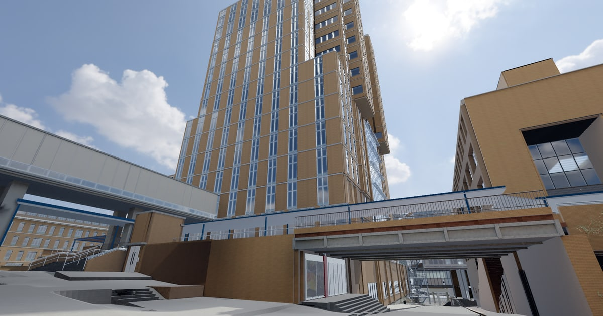
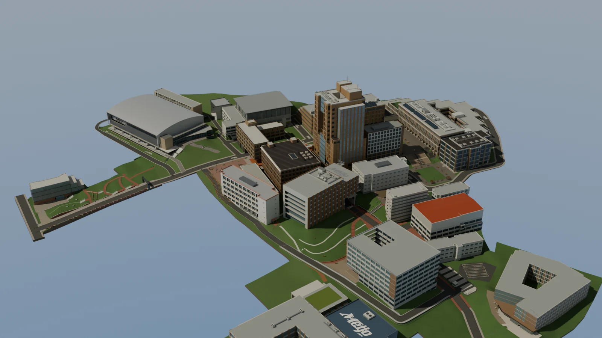
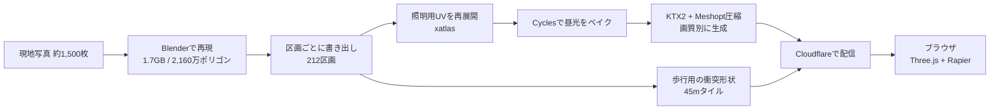

# 名城大学 天白キャンパス 3D（非公式）

> A walkable, browser-based 3D model of Meijo University's Tempaku campus, rebuilt from about 1,500 on-site photos. A 1.7 GB, 21.6M-triangle Blender scene is split into 212 chunks with baked Cycles lightmaps, KTX2/Meshopt compression and a per-device memory budget, plus a separate Rapier collision mesh for walking. Built solo by directing AI coding agents; current work runs on Claude Code. Live: https://meijo-3d-unofficial.yuustudio.app/

**1.7GBのBlenderモデルを、スマートフォンのブラウザでも歩けるWeb 3Dにした個人制作です。**

約1,500枚の現地写真をもとに、キャンパス全体をBlenderで再現しました。光の事前計算・区画分割・端末に合わせたメモリ管理で、インストール不要のWebで歩いて見学できます。

**▶ 公開サイト: https://meijo-3d-unofficial.yuustudio.app/** （PC・スマートフォン対応）

https://github.com/user-attachments/assets/7a20d3ad-06dc-4e5c-a512-6dee352846a6





## 規模

| 項目 | 値 |
| --- | --- |
| 元のBlenderモデル | 約1.7GB、6,962オブジェクト、約2,160万ポリゴン |
| 参照した現地写真 | 約1,500枚 |
| Web配信 | 212区画に分割、821ファイル（1ファイル25MiB未満） |
| 光の事前計算 | 138区画にCyclesで昼光をベイク、スマホ向けに軽量版も生成 |
| 歩行用の衝突判定 | 表示用とは別の軽量形状、45m四方×84タイル、約311万ポリゴン |
| 樹木 | 271本、3段階の詳細度（LOD） |
| 制作期間 | 2026年8月〜（継続中） |

## 技術的なポイント：重いモデルをスマホで動かす

そのまま読み込むと数GBになるモデルを、次の工程でブラウザが扱える量にしています。



- **光の事前計算（ライトマップ）**: リアルタイムでは重い大域照明を、Blender Cyclesであらかじめ計算しテクスチャに焼き込みます。表面の模様用UVと照明用UVを分け、照明側は [xatlas](https://github.com/jpcy/xatlas) で詰め直して解像度を確保しています（[`scripts/repack_lightmap_uv.py`](scripts/repack_lightmap_uv.py)、[`docs/LIGHTING.md`](docs/LIGHTING.md)）。スマホでも、影を毎フレーム計算せずに陰影のある見た目になります。
- **区画分割と画質別の配信**: 建物・外構を212区画に分け、KTX2（GPU向けテクスチャ圧縮）とMeshopt（形状圧縮）で配信します。照明データは「軽量／標準／精細」を別々に生成し、端末に合う画質を選べます（[`app/viewer/quality.ts`](app/viewer/quality.ts)）。
- **端末に合わせたメモリ上限**: ブラウザが報告するメモリ量・CPUコア数・GPU名・タッチ操作の有無から、最初に保持するモデル量を140MB〜2GBで自動判定します。利用者は設定で変更できます（[`app/viewer/memory-budget.ts`](app/viewer/memory-budget.ts)）。
- **見えない区画は読まない**: 視点と遮蔽をもとに読み込む区画を選びます（[`app/viewer/occlusion-streaming.ts`](app/viewer/occlusion-streaming.ts)、[`lod-policy.ts`](app/viewer/lod-policy.ts)）。
- **歩行と物理**: 表示用モデルとは別の軽量な衝突形状を、物理エンジン [Rapier](https://rapier.rs/) でWeb Workerから読み込みます。重力・ジャンプ・階段・壁の判定があり、画質や読み込み状況に関係なく同じ床を歩けます（[`app/viewer/rapier-walk.ts`](app/viewer/rapier-walk.ts)、[`collider-worker.ts`](app/viewer/collider-worker.ts)）。
- **壊れにくさ**: GPUが切断されたときの再試行、通信失敗からの再読み込み、直近の安全な床への復帰、新しいモデルを公開したときの更新通知に対応しています。

## 品質の確認

```bash
npm ci
npm run typecheck
node --test tests/*.test.mjs   # 70テスト
```

移動・描画・物理・端末の判定・歩行の開始と終了について、70件のテストがあります。公開前の検査として、元のモデルと配信データ（形状・衝突・照明）のSHA-256一致もビルド時に確認しています（[`scripts/validate_viewer_v3.mjs`](scripts/validate_viewer_v3.mjs)）。

## 制作の進め方

一人でキャンパス全体を作るため、AIコーディングエージェントをチームとして使っています。自分は方針・現地での撮影・検収を担当し、Blenderの操作や変換・検証のコードはエージェントに指示して書かせています。現在の改修とWeb公開はClaude Codeで進めています。

### 自分が決めたこと

- **全体の基準を先に決めさせた**: 一区画ずつ直す案が完成度に届かなかったため、作業を止めて「何を基準に、どの順で直すか」の全体計画を先に作らせた。配置図の線を種類別のデータにし、今のモデルとのずれを地図にして優先度を決める計画になった。
- **建物を正、地形は従**: 写真で確認できる建物・入口・階段を基準にし、根拠のない既存の地形は作り直してよい、という方針を出した。
- **一括処理を禁止**: 地形を一括で生成した結果の品質が低かったため、区間ごとに配置図と写真で照合し、目視で確認しながら作る進め方に変えさせた。
- **見た目を落とす軽量化はしない**: 樹木や草を簡略な形に置き換える案は却下し、光の事前計算のような見た目に影響しない軽量化だけを採用した。
- **画質を勝手に下げない**: 動作が重いときに自動で画質を下げる仕組みは入れず、利用者が選んだ画質を保つことにした。

### ルールを文書にする

「写真などの根拠がある形だけを作る」「推定した寸法は推定と記録する」「保存前に必ずバックアップを取る」といったルールを文書にし、エージェントが毎回それに従うようにしています。作業の続きは `PROGRESS.md` の「次にやること」から再開させ、長い作業でもセッションをまたいで引き継げるようにしています。

## 構成

| パス | 内容 |
| --- | --- |
| [`app/viewer/`](app/viewer/) | Webビューア本体（TypeScript、Three.js、React） |
| [`scripts/`](scripts/) | Blenderからの書き出し、照明のベイク・再パック、配信データの生成・検証 |
| [`tests/`](tests/) | ビューアのテスト |
| [`data/viewer/`](data/viewer/) | 移動先・歩行開始位置・照明などの設定 |

## このリポジトリについて

8月から続けている制作用リポジトリ（非公開）から、Webビューアのコードと変換・検証スクリプトを公開用に抜き出したものです。Blenderの元モデル、写真、配信用のモデルデータは含めていません。動作は[公開サイト](https://meijo-3d-unofficial.yuustudio.app/)で確認できます。

- 名城大学の公式サイト・公式案内ではありません。寸法には写真からの推定を含みます。
- 樹木モデル: Daniel / danielpetrov 作（CC BY 4.0）

## 作者

kou（名城大学 情報工学部 2年）。Kaggleでのエージェントの使い方は [kaggle-competitions](https://github.com/yuu737/kaggle-competitions) を参照してください。
